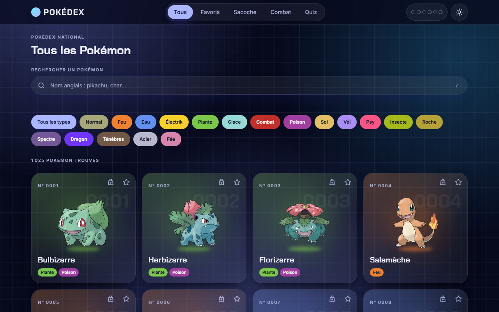
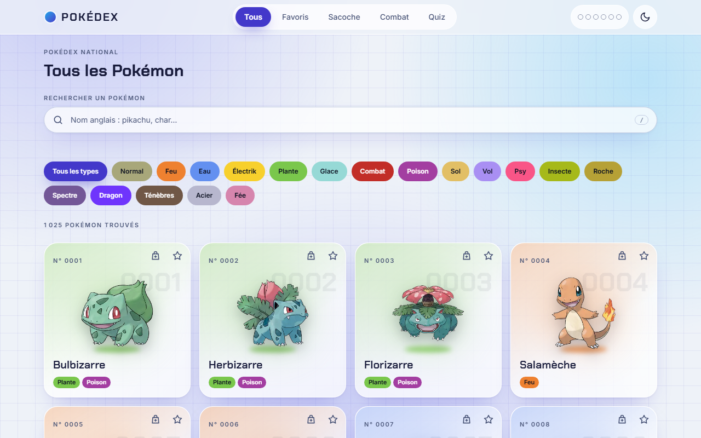
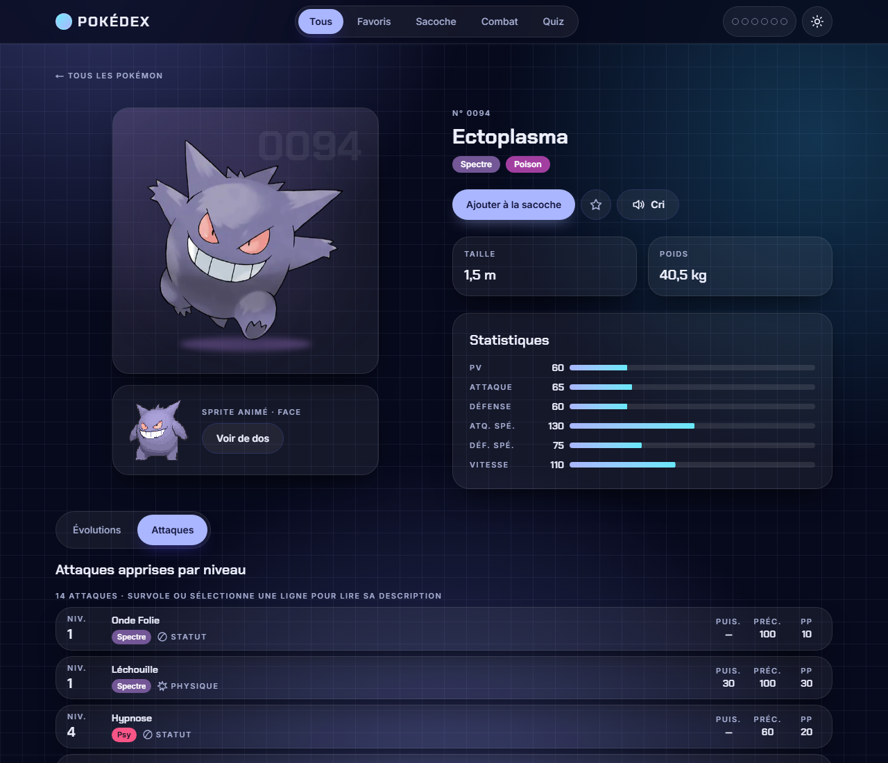
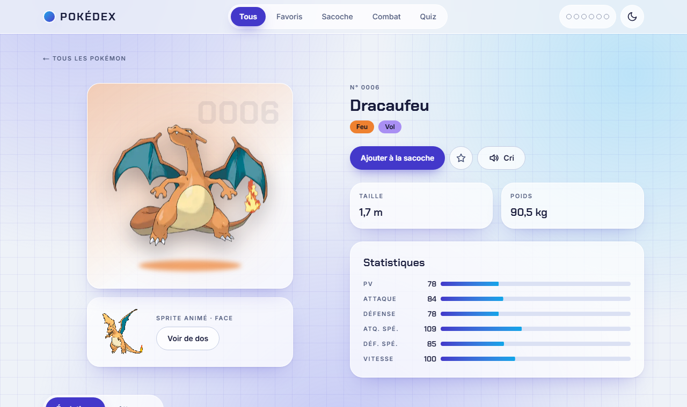

# Pokédex — Next.js 16

Un Pokédex complet construit avec **Next.js 16 (App Router)**, **TypeScript** et **Tailwind CSS 4**, à partir des
données publiques de la [PokéAPI](https://pokeapi.co) : liste, fiches détaillées, favoris, équipe, combats au tour
par tour et quiz. Projet de fin de cours.

**Démo en ligne : https://pokedex-pi-coral-47.vercel.app**

## Captures

| Thème sombre | Thème clair |
| --- | --- |
|  |  |
|  |  |

## Fonctionnalités

- **Liste des 1 025 Pokémon** en grille paginée (24 par page), avec noms français.
- **Recherche** avec debounce, **filtre par type** et **pagination** entièrement pilotés par l'adresse
  (`?q=&type=&page=`), validés côté serveur.
- **Fiche détaillée** : illustration officielle, types, taille, poids, six statistiques, sprite animé (face / dos),
  cri, chaîne d'évolution cliquable et **attaques apprises par niveau** (type, catégorie, puissance, précision, PP,
  description).
- **Favoris** et **sacoche** conservés dans le navigateur ; la sacoche est une « arène d'équipe » : 6 socles animés,
  détail du membre sélectionné, surnoms, 4 attaques par Pokémon, ordre modifiable par glisser-déposer ou au clavier.
- **Mode combat** : ta sacoche contre une équipe tirée au hasard, au niveau 50 — efficacité des 18 types, dégâts,
  précision, ordre selon la vitesse, IA adverse, effets d'attaque animés par type, journal de combat accessible.
- **Quiz « Qui est ce Pokémon ? »** : une silhouette, quatre propositions, révélation animée.
- **Direction artistique « verre holographique »** : panneaux translucides, une teinte par Pokémon (couleur de son
  type principal), soignée en clair comme en sombre. Le thème suit le système et le choix est mémorisé.
- **Animations** : apparition en cascade, inclinaison 3D des cartes, transition partagée de l'illustration entre la
  grille et la fiche (View Transitions) — uniquement `transform` et `opacity`, et réduites à de simples fondus avec
  `prefers-reduced-motion`. Aucun son automatique.
- **Accessibilité** : navigation au clavier, focus visible, libellés ARIA, zones `aria-live`, contrastes vérifiés
  dans les deux thèmes.

## Stack

| Domaine | Choix |
| --- | --- |
| Framework | Next.js 16 — App Router, Cache Components (`"use cache"`), Partial Prerendering |
| Langage | TypeScript |
| Styles | Tailwind CSS 4 (configuration dans `app/globals.css` avec `@theme`) |
| État client | Zustand (`persist` + réhydratation après l'hydratation React) |
| Thème | next-themes |
| Animations | motion (`motion/react`) et CSS, `prefers-reduced-motion` respecté |
| Tests | vitest (fonctions pures de `lib/combat.ts`) |
| Données | PokéAPI v2 (lecture seule, sans clé) |
| Hébergement | Vercel |

## Architecture

```
app/          Routes : liste, fiche /pokemon/[nom], favoris, sacoche, combat, quiz, à propos, routes /api
components/   Composants d'interface — serveur par défaut, client seulement pour l'interactivité
hooks/        Hooks réutilisables (debounce, raccourci clavier, chargement client, cri…)
lib/          Accès à la PokéAPI, conversion des données, validation de l'adresse, moteur de combat
stores/       Stores Zustand (favoris, sacoche) avec leurs règles métier
```

Quelques principes suivis dans le code :

- **Composants serveur par défaut** ; `"use client"` uniquement sur de petites feuilles interactives.
- **Données mises en cache côté serveur** (`"use cache"` + `cacheLife("days")`) ; les 151 premières fiches sont
  générées au build avec `generateStaticParams`.
- **Tout ce qui dépend de la requête** (`params`, `searchParams`) est lu sous `<Suspense>`.
- **L'état partageable vit dans l'adresse** : recherche, type, page, onglet de la fiche.
- **Les données restent en anglais** (`fire`) et ne sont traduites qu'à l'affichage.
- **Les règles métier vivent dans les stores** (6 Pokémon maximum, pas de doublon).
- **Le moteur de combat est fait de fonctions pures** : le hasard leur est passé en argument, ce qui les rend
  testables.

## Qualité

Audit Lighthouse (mobile) sur le site déployé :

| Page | Performance | Accessibilité | Bonnes pratiques | SEO |
| --- | --- | --- | --- | --- |
| Accueil | 90 | 100 | 100 | 100 |
| Fiche | 98 | 100 | 100 | 100 |
| Sacoche, combat, quiz, favoris | — | 100 | 100 | 100 |

Les fonctions du combat sont couvertes par 23 tests unitaires (`npm test`).

## Lancer le projet

Prérequis : Node.js 20 ou plus.

```bash
npm install
npm run dev      # http://localhost:3000
```

Autres commandes :

```bash
npm run lint        # ESLint
npm run typecheck   # vérification des types TypeScript
npm test            # tests unitaires (vitest)
npm run build       # build de production (nécessite un accès à la PokéAPI)
npm start           # sert le build de production
npm run clean       # supprime le dossier .next
```

Les mêmes commandes sont disponibles en raccourcis avec [`make`](Makefile) ou [`just`](justfile) :

```bash
make help    # ou : just
make check   # lint + typecheck + test + build, à lancer avant un commit
```

## Déploiement

Le site est déployé sur Vercel : https://pokedex-pi-coral-47.vercel.app (redéployé à chaque `git push` sur `main`).

L'application a besoin d'un serveur Node.js (rendu serveur, cache, routes dynamiques) : elle se déploie sur
[Vercel](https://vercel.com) ou tout hébergeur Node.js. Elle ne peut pas être servie telle quelle par un hébergement
purement statique.

## Crédits et mentions

- Données, illustrations, sprites et cris : [PokéAPI](https://pokeapi.co). Sprites animés issus de Pokémon Showdown.
- Pokémon est une marque de Nintendo / Game Freak / The Pokémon Company. Projet étudiant non commercial, sans
  affiliation avec ces sociétés.
